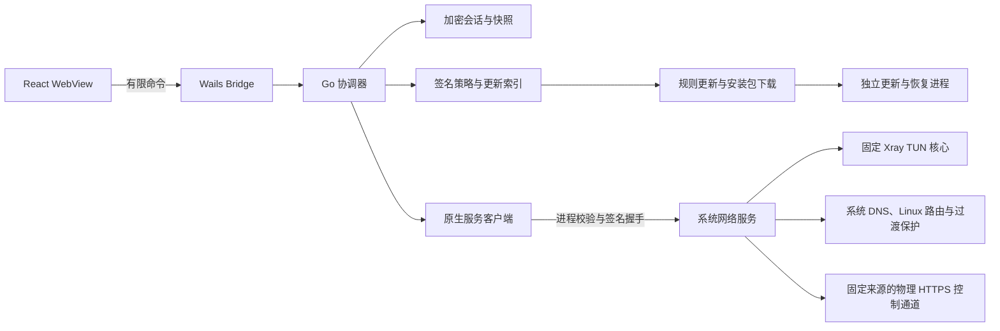

# 架构与资源责任

WebView 只收到脱敏 AppView；token、订阅 URL、节点凭据和原始配置留在 Go 协调器或受保护服务。Bridge 对命令执行严格 JSON 和字段校验。Go 协调器串行协调同步，过期和限制优先于连接意图。完整快照最多有效 24 小时，单独账号读取只收紧期限。

安装版通过 NativeDriver 发出有限请求，原生端只接受结构化节点、固定规则与模式，自己编译 Xray 配置。UnavailableDriver 仅作为未注入驱动/演示的失败默认值。运行就绪由实际服务身份、构建 ID 和组件完整性决定，验收矩阵不冒充运行能力。

| 资源 | 所有者 |
| --- | --- |
| 系统代理模式的 Xray 与回环代理端口 | 应用（经 helper 的非特权 proxy-core 工作进程） |
| 系统代理设置与恢复日志 system-proxy.json | Go 协调器（ProxyDriver，当前用户权限） |
| TUN 接口 | 固定版本 Xray |
| Linux 策略路由、per-link resolved、nftables | systemd helper |
| macOS 系统路由、出站绑定默认路由网卡 | Xray TUN（autoSystemRoutingTable、autoOutboundsInterface auto） |
| macOS 主网络服务 DNS 及比较恢复 | launchd helper |
| Windows 适配器路由/DNS/动态 WFP、出站绑定默认路由网卡 | Xray Windows TUN |
| Windows 遗留 Wintun 适配器清理（pnputil） | Windows helper service |
| 应用会话与连接意图 | Go 协调器 |
| 安装备份、平台安装器、中断恢复 | 独立更新进程 |

客户端先验证服务对随机挑战的 Ed25519 签名，再提交请求。安装生成的私钥仅存于系统保护目录。服务检查 OS peer PID、UID/SID、进程出生标识、应用路径、允许的启动参数及内嵌前端资源的应用可执行文件哈希，未变更的受保护文件复用验证结果。命名管道拒绝匿名网络用户。没有任意 shell、任意核心路径或 raw Xray JSON 的特权 IPC。

准备阶段不接管全局网络，随后进入有界事务。服务独立管理截止和单调时钟，心跳失联、核心结束、授权过期及路由/DNS 变化触发清理。日志只记录资源所有权与恢复资料，不记录节点密码。服务重启优先恢复，独立修复不依赖 GUI 或在线面板；恢复未确认时保留错误状态。

控制 API/规则/策略下载使用物理绑定 HTTPS，固定来源、不跟随重定向。核心直连出站绑定物理接口，Linux 同时使用 fwmark 防环路。规则和 DNS 由服务端固定模板编译。默认 TLS/REALITY 指纹 hellochrome_120 使用 X25519 初始 key share，订阅显式指纹优先。

隔离节点探测使用父进程绑定、限时的非特权工作进程。TUN 提交需要 TCP/UDP/DNS/IPv6 证明，未通过时不报告已连接。真实兼容性留待用户在目标系统验收。

更新索引在Go 协调器与原生端分别验签、校验环境/渠道/时间/水位/撤回项。文件复制到保护目录后重新验证哈希和平台签名；独立进程等待 GUI 退出、清理网络、备份再安装。中断日志在服务启动时触发恢复。打包器不重新签名已固定哈希的核心/helper，签名顺序见 native-service.md。

Go 单元/竞态测试、TypeScript 兼容对照、浏览器预览测试和产物内容校验分别验证逻辑、协议与打包约束；这些检查不等于四平台真实 TUN、睡眠唤醒或断电恢复验收。实测记录见 `wails-migration.md`。

Wails 外壳只加载内嵌资源，开发构建允许显式启用本机 Vite。生产 CSP 不包含开发 WebSocket。关闭到托盘会销毁 WebView 窗口，再次打开时重建；没有窗口时无需持续向 WebView 发送状态。会话以 AES-256-GCM 写入 `session.v2.enc`，数据目录按固定 `appId` 定位，不含版本号。macOS 的 32 字节数据密钥保存在同目录的 `session-key.key`，权限为 0600；Windows 使用 Credential Manager，Linux 使用 Secret Service。macOS 发现旧密文但缺少密钥文件时，按原 `appId` 和 `session-key` 读取旧钥匙串，成功解密后再保存密钥文件。迁移失败保留密文，不生成替代密钥；首次安装不查询旧钥匙串。无已存会话且密钥存储不可用时只留内存，有密文但无法解密时锁定。版本变更不清理登录态；恢复时仍检查产品和环境，主动退出登录和服务端明确拒绝令牌时清理会话。

自建端点（server/）提供签名的更新索引、运营策略、规则与安装包文件、下载页，并接收遥测和问题报告。客户端按构建配置中的端点顺序请求，规则与更新包在主域名失败时按相同路径换备用域名，内容仍按签名和哈希校验。遥测由 Go 协调器排队（本地文件，最多 1000 条），每几分钟批量发送；面板请求经观察器记录域名可达性，只记主机名。问题报告在应用进程内做网络自检（系统 DNS 与 DoH 对比、TCP/TLS/HTTPS、节点 TCP），不经过原生服务。

连接方式由偏好 tunnel 决定，TunnelDriver 把每次连接交给 ProxyDriver（"proxy"，默认）或 NativeDriver（"tun"），断开和启动清理两者都做。系统代理模式不经过原生服务：应用在 Go 端编译配置（127.0.0.1 上无认证的 HTTP/SOCKS mixed 端口，优先 7890，另有带随机凭据的健康检查 SOCKS 端口），路由、DNS 分流与负载均衡与 TUN 配置一致；规则模式用 IPIfNonMatch 并以地址规则收尾，名单外的域名解析后按地址分流。打包版通过 helper 的 proxy-core 工作进程运行核心：只接受回环 mixed/socks 入站和固定协议出站，校验核心哈希，应用退出即结束核心。经健康检查端口取到健康目标后，先写恢复日志再设置系统代理；断开、核心退出和下次启动时按日志恢复原设置，恢复失败保留日志并显示需要修复。修复命令在系统代理模式只做恢复，不安装原生服务。广告拦截关闭时，协调器在两种模式下都去掉 block 段。

连接时原生服务收到用户节点和节点池：自动模式下 Xray 用 observatory 与 leastPing 在节点池中选路，AI 分段走只含合格地区节点的负载均衡。节点池中每个节点的地址都在准备阶段经物理网卡解析并加入绕行路由。

Windows 与 macOS 的 TUN 按 v2rayN 的方式运行：路由由 Xray 自己添加和移除，Xray 自身连接绑定到默认路由所在网卡并随网络切换自动跟随，因此网络变化不再断开重连，也没有防火墙/PF 过渡保护（核心路由生效前流量照常直连）。连接前移除本产品遗留的 Wintun 适配器（与 v2rayN 相同，按网卡名 MD5 推导设备 GUID）。服务在状态目录写 helper.log（失败的步骤与系统命令，不含节点与流量）和 core.log（核心启动输出），用于实机排查。
