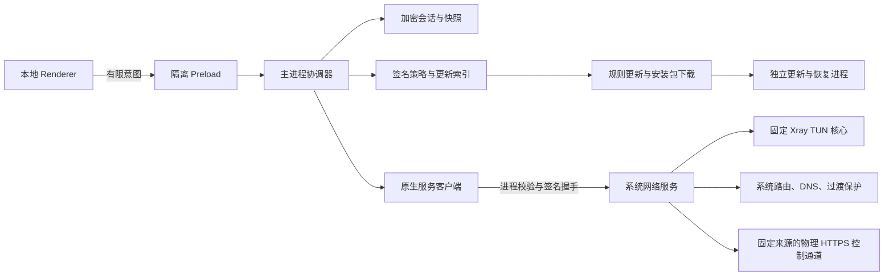

# 架构与资源责任

Renderer 只收到脱敏视图；token、订阅 URL、节点凭据和原始配置留在主进程或受保护服务。主进程串行协调同步，过期和限制优先于连接意图。完整快照最多有效 24 小时，单独账号读取只收紧期限。

安装版通过 NativeDriver 发出有限请求，原生端只接受结构化节点、固定规则与模式，自己编译 Xray 配置。UnavailableDriver 仅作为未注入驱动/演示的失败默认值。运行就绪由实际服务身份、构建 ID 和组件完整性决定，验收矩阵不冒充运行能力。

| 资源 | 所有者 |
| --- | --- |
| TUN 接口 | 固定版本 Xray |
| Linux 策略路由、per-link resolved、nftables | systemd helper |
| macOS split routes、DNS 比较恢复、PF anchor | launchd helper |
| Windows 适配器路由/DNS/动态 WFP | Xray Windows TUN |
| Windows 临时防火墙 | Windows helper service |
| 应用会话与连接意图 | Electron 主进程 |
| 安装备份、平台安装器、中断恢复 | 独立更新进程 |

客户端先验证服务对随机挑战的 Ed25519 签名，再提交请求。安装生成的私钥仅存于系统保护目录。服务检查 OS peer PID、UID/SID、进程出生标识、应用路径、允许的启动参数及应用/ASAR 哈希，未变更的受保护文件复用验证结果。命名管道拒绝匿名网络用户。没有任意 shell、任意核心路径或 raw Xray JSON 的特权 IPC。

准备阶段不接管全局网络，随后进入有界事务。服务独立管理截止和单调时钟，心跳失联、核心结束、授权过期及路由/DNS 变化触发清理。日志只记录资源所有权与恢复资料，不记录节点密码。服务重启优先恢复，独立修复不依赖 GUI 或在线面板；恢复未确认时保留错误状态。

控制 API/规则/策略下载使用物理绑定 HTTPS，固定来源、不跟随重定向。核心直连出站绑定物理接口，Linux 同时使用 fwmark 防环路。规则和 DNS 由服务端固定模板编译。默认 TLS/REALITY 指纹 hellochrome_120 使用 X25519 初始 key share，订阅显式指纹优先。

隔离节点探测使用父进程绑定、限时的非特权工作进程。TUN 提交需要 TCP/UDP/DNS/IPv6 证明，未通过时不报告已连接。真实兼容性留待用户在目标系统验收。

更新索引在主进程与原生端分别验签、校验环境/渠道/时间/水位/撤回项。文件复制到保护目录后重新验证哈希和平台签名；独立进程等待 GUI 退出、清理网络、备份再安装。中断日志在服务启动时触发恢复。打包器不重新签名已固定哈希的核心/helper，签名顺序见 native-service.md。

本轮未运行测试，以上是实现职责，不是实机验收结论。
